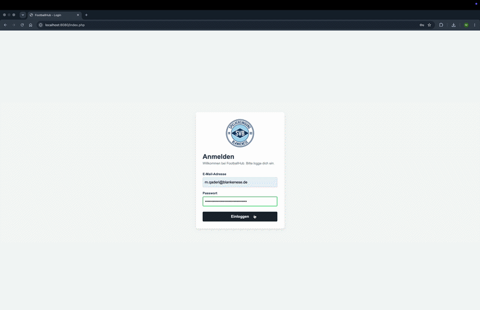
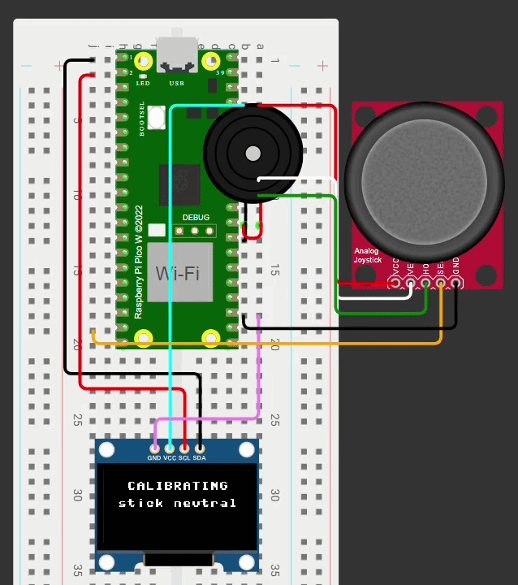

  

  <!-- HIER DEINE ECHTE E-MAIL EINTRAGEN -->
  
  
  
  

---

### 👨‍💻 SYSTEM_OVERVIEW // ÜBER_MICH

Als angehender **Fachinformatiker für Systemintegration** (voraussichtlicher Abschluss: **Januar 2028** in Hamburg) ist es mein Ziel, die Brücke zwischen robuster IT-Infrastruktur und moderner Softwareentwicklung zu schlagen. 

Mein analytisches Fundament habe ich durch ein Informatikstudium (Fokus auf theoretische Informatik, Rechnerarchitektur & Java) gelegt. Heute kombiniere ich dieses Wissen mit praxisnaher System- und Netzwerkadministration. Egal, ob ich Linux- und Netzwerklandschaften konfiguriere, Cloud-Deployments via CI/CD automatisiere oder Full-Stack-Anwendungen containerisiere – ich bin in meinem Element, wenn Hard- und Software nahtlos ineinandergreifen.

🌍 **Sprachen:** Deutsch (Muttersprache) &nbsp;•&nbsp; Dari (Muttersprache) &nbsp;•&nbsp; Englisch (Fließend) &nbsp;•&nbsp; Spanisch (Grundkenntnisse)

> 💡 *Ich bin aktiv auf der Suche nach **Praktika, Werkstudentenstellen und spannenden Praxisprojekten** in den Bereichen Systemintegration, Cloud-Architektur oder DevOps.*

---

### ⚙️ CORE_TECHNOLOGIES // MEIN_TECH_STACK

<b>Infrastruktur, Cloud & DevOps</b>

  

<b>Sprachen, Web & Datenbanken</b>

  

<b>IDE, Design & Engines</b>

  

---

### 🚀 FEATURED_PROJECTS // MEINE_PROJEKTE

<table border="0" width="100%">
<tr>
<td width="55%" valign="top">
  
  
<b>Rollenbasierte Web-App (Aktuell in DevOps-Migration)</b> 
  Ursprünglich als lokales PHP/MySQL-Projekt während der Umschulung entwickelt, überführe ich diese Anwendung derzeit in eine produktionsnahe Cloud-Architektur. Der Fokus liegt auf Multi-Container-Umgebungen (Docker) sowie automatisierten Build- und Deployment-Pipelines.

  
  

    
    
    
     
    
    
    
    
  

</td>
<td width="45%" align="center" valign="middle">
  
</td>
</tr>
  
<tr>
<td width="55%" valign="middle">
   
  
  
<b>Echtzeit-Multiplayer-App (Fokus: Hosting & Deployment)</b> 
  Entstanden aus dem Wunsch nach einer eigenen Alternative zu unseren abendlichen Discord-Runden. Durch AI-Assisted Prototyping konnte ich die Applikationslogik zügig als Proof-of-Concept umsetzen und meinen Schwerpunkt voll auf die Systemintegration legen: Bereitstellung der Node.js-Laufzeitumgebung, Echtzeit-Synchronisation via WebSockets (Socket.io) und das Live-Deployment über Render.

  

    
    
    
    
     
    
    
    
  

  
  
  <i>(Free-Tier-Instanz: Cold-Start kann ~30 Sek. dauern)</i>
    
</td>
<td width="45%" align="center" valign="middle">
  
</td>
</tr>

<tr>
<td width="55%" valign="middle">
  
  
<b>Eingebettete Retro-Arcade-Konsole</b> 
  Entwickelt auf einem Raspberry Pi Pico 2W mit OLED-Display und Hardware-Joystick. Ein intensives Hands-on-Projekt zur direkten Ansteuerung von Mikrocontrollern und der Verzahnung von Hardware-Komponenten mit hardwarenahem Code.

  

    
    
    
  

</td>
<td width="45%" align="center" valign="middle">
  
</td>
</tr>
</table>

---

### 🎯 CURRENT_LEARNING_FOCUS // AKTUELLER_FOKUS

  
  
<b>CI/CD & IaC (GitHub Actions / Terraform) &nbsp;•&nbsp; Netzwerktechnik (TCP/IP, Routing, Subnetting) & Linux &nbsp;•&nbsp; IT-Security</b>

  
  
  
<b>Cloud-Migration (FootballHub) &nbsp;•&nbsp; Containerisierung & Orchestrierung (Docker)</b>

  
  
<b>Advanced Linux & Bash Scripting &nbsp;•&nbsp; Terminal-Automatisierung &nbsp;•&nbsp; Cloud Architecture (AWS)</b>

---

### ⚡ BEYOND_THE_TERMINAL // ABSEITS_VOM_BILDSCHIRM

Wenn ich nicht gerade an Systemen schraube oder code, passiert meistens das hier:

- 🎵 **FL Studio:** Beats produzieren – seit über 15 Jahren mein kreatives Ventil.
- 🎹 **Klavier:** Spiele nach Gehör, seit ich 5 bin (damals inspiriert von *"Little Einsteins"* 🚀).
- 🛠️ **Hardware:** Custom-PCs bauen und der typische Familien-IT-Notdienst sein.
- 🎮 **Unreal Engine:** In der Freizeit eigene Spiele-Ideen zum Leben erwecken.
- ⚽ **Fußball:** Auf dem Platz stehen, um nach dem vielen Sitzen den Kopf frei zu kriegen.

---

### 📈 GITHUB_ANALYTICS

  

 

  
<em>Ich bin jederzeit offen für Gespräche über Praktika, Werkstudentenstellen und Möglichkeiten in den Bereichen <b>Systemintegration, Cloud & DevOps</b>.</em>

  
   
  
   
  © 2026 Musawar Qaderi • Entwickelt in Hamburg ⚓

